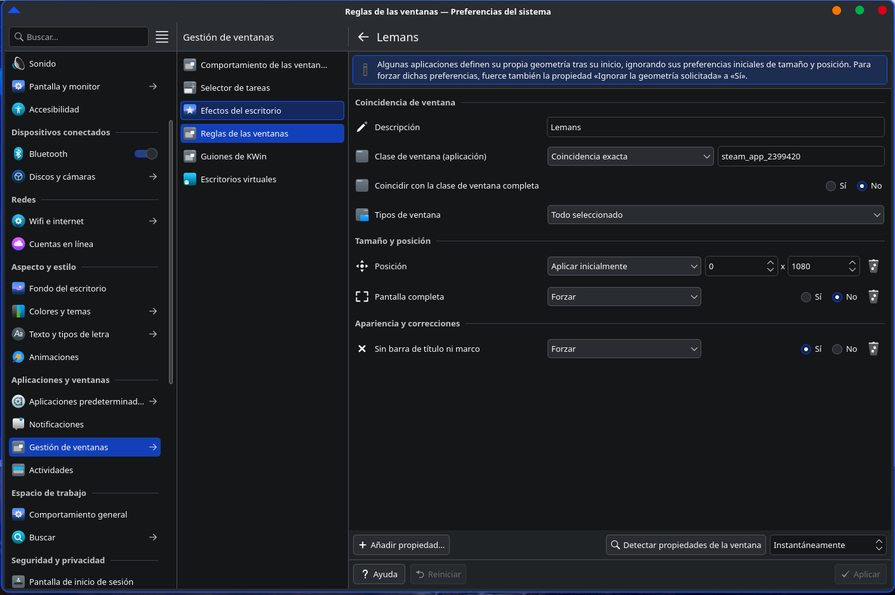

# LMU Linux Triple Monitor Guide (ES / EN)

Guide for setting up Le Mans Ultimate on Linux with SimHubDash and CrewChief, including a triple-monitor configuration (7680×1440 @ 144Hz) using Wayland.

## ⚠️ Important Notice / Aviso importante

### 🇬🇧 English

The installation and configuration methods for SimHubDash and CrewChief described in this guide are still functional. However, I now recommend using **[ETOL (Easy Telemetry on Linux)](https://github.com/pabeernosmatao/ETOL-Easy-Telemetry-on-Linux)**, which simplifies the installation and configuration of these applications.

The triple-monitor configuration without Gamescope described in this repository is still fully valid. However, **[ETOL](https://github.com/pabeernosmatao/ETOL-Easy-Telemetry-on-Linux)** also supports running LMU both with and without Gamescope.

You can therefore continue using the manual installation instructions in this guide or use **[ETOL](https://github.com/pabeernosmatao/ETOL-Easy-Telemetry-on-Linux)** as the recommended alternative.

### 🇪🇸 Español

Los métodos de instalación y configuración de SimHubDash y CrewChief descritos en esta guía siguen siendo funcionales. Sin embargo, actualmente recomiendo utilizar **[ETOL (Easy Telemetry on Linux)](https://github.com/pabeernosmatao/ETOL-Easy-Telemetry-on-Linux)**, que simplifica la instalación y configuración de estas aplicaciones.

La configuración de triple monitor sin Gamescope descrita en este repositorio sigue siendo completamente válida. No obstante, **[ETOL](https://github.com/pabeernosmatao/ETOL-Easy-Telemetry-on-Linux)** también permite ejecutar LMU tanto con Gamescope como sin él.

Por tanto, puedes seguir utilizando las instrucciones de instalación manual de esta guía o recurrir a **[ETOL](https://github.com/pabeernosmatao/ETOL-Easy-Telemetry-on-Linux)** como alternativa recomendada.

---

## 🌍 Languages / Idiomas

* 🇪🇸 Spanish → [Spanish/](Spanish/)
* 🇬🇧 English → [English/](English/)

---

## 🚀 What this project includes / Qué incluye este proyecto

* Le Mans Ultimate (LMU) on Linux (CachyOS + KDE Plasma)
* SimHubDash telemetry, dashboards and overlays
* CrewChief integration
* Triple-monitor setup (7680×1440 @ 144Hz)
* Wayland support
* Manual triple-monitor configuration without Gamescope
* **[ETOL](https://github.com/pabeernosmatao/ETOL-Easy-Telemetry-on-Linux)** compatibility (with or without Gamescope)

---

## ⚠️ Notes / Notas

* Tested on CachyOS + KDE Plasma
* Designed for Wayland systems
* Focused on triple-monitor racing setups
* The manual triple-monitor configuration does not require Gamescope
* **[ETOL](https://github.com/pabeernosmatao/ETOL-Easy-Telemetry-on-Linux)** can be used with or without Gamescope

---

## 🛑 Contributions / Contribuciones

* **🇪🇸 Español:** Este manual se considera un proyecto finalizado. Por motivos de tiempo y falta de hardware para realizar pruebas, no se aceptan Pull Requests ni sugerencias externas. Las interacciones en este repositorio han sido restringidas.
* **🇬🇧 English:** This guide is considered a completed project. Due to time constraints and lack of testing hardware, external Pull Requests and contributions are not accepted. Repository interactions have been restricted.

---

# 📸 Screenshots

## SimHubDash

---

## Triple Monitor Setup

---

## KDE Plasma Window Rule

